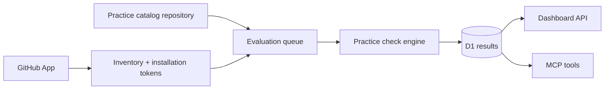

# Shipshape

[](https://github.com/aranlucas/shipshape-mcp/actions/workflows/ci.yml)
[](LICENSE)

Shipshape checks Lucas's engineering practices across his repositories. A
GitHub App inventories the repositories it can access, reads a versioned
practice catalog, evaluates bounded checks at each default-branch commit, and
stores the results for the dashboard and MCP.

The service covers personal and organization repositories, including private
repositories. The GitHub user token is used only to identify the owner; all
repository reads use installation tokens. Results preserve `pass`, `fail`,
`unknown`, and `not_applicable` states.

## Connect

```bash
codex mcp add shipshape \
  --url https://shipshape-mcp.aranlucas.workers.dev/mcp \
  --oauth-client-registration auto
```

The MCP tools are `practices_overview`, `repo_practices`, and
`practice_detail`. The browser dashboard is available at
[`/app`](https://shipshape-mcp.aranlucas.workers.dev/app).

## Practice catalog

Practices live in the private `aranlucas/practices` catalog repository. Each
practice has a strict `practice.yml` definition and may include canonical files
and agent instructions. Checks cover repository files, JSON/YAML paths,
dependencies, repository settings, branch protection, and workflow security.

The dashboard and API contract are documented in
[`docs/architecture.md`](docs/architecture.md); the TypeScript response source
of truth is [`src/api/contract.ts`](src/api/contract.ts). Setup instructions
for the GitHub App, D1 database, queue, and catalog repository are in
[`docs/setup.md`](docs/setup.md).

## Develop

```bash
pnpm install --frozen-lockfile
cp .dev.vars.example .dev.vars
pnpm types
pnpm check
pnpm dev
```

The dashboard is a Preact bundle in `src/ui`. Work on it without GitHub
credentials using fixture data in the API contract's shape:

```bash
pnpm ui:dev   # http://localhost:5200/app/
```

`pnpm ui:build` writes the bundle to `public/app/`, which the Worker serves as
static assets; `pnpm build`, `pnpm dry-run`, and `pnpm preview` run it first.
Run it once before `pnpm dev` so the Worker can serve the dashboard shell.

See [`SECURITY.md`](SECURITY.md) for the security boundary and reporting
instructions.

## Architecture



- `src/github/app.ts` creates App and installation clients.
- `src/inventory/sync.ts` refreshes every installation's repositories.
- `src/practices/` parses the catalog, reads bounded repository snapshots, and
  evaluates checks.
- `src/queue.ts` and `src/scheduled.ts` trigger evaluation after pushes and on
  the daily sweep.
- `src/api/routes.ts` and `src/mcp.ts` expose the shared response contract.

## Local checks

`pnpm check` runs generated Worker types, typechecking, linting, formatting,
the node and Worker test projects, and a Cloudflare dry run. Repository reads
are bounded and no repository code is cloned, executed, or mutated by the
Worker.
